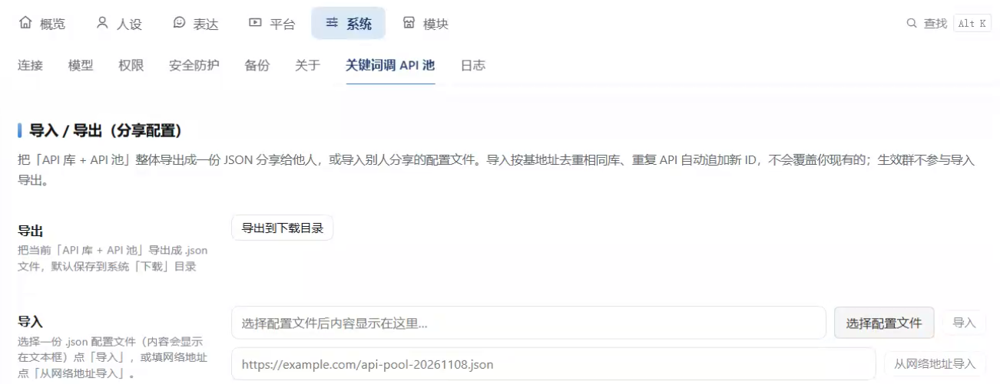

# 关键词调 API 池 (api-pool)

只在指定群里，群友发某个关键词就自动调用你设定好的接口，把返回的文本 / 图片 / 视频 / 音频直接发回群里；也支持「混合」类型——一条响应里的文字与图片/视频/音频直链分成多条消息依次发回。纯机械触发，不经过模型，不费 token。

## 功能



- **生效范围是全局的**：面板「生效范围（全局）」里统一填生效群、触发范围、触发人黑名单，对所有接口一次生效，不用一条条改（详见「生效范围（全局）」）。
- 支持数据类型：文本、图片、视频、语音、混合（文字 + 图片/视频/音频分多条发）。
- 每个接口独立配置：请求地址、请求方式（GET/POST）、参数、数据类型、解析表达式、回复模板、错误模板、触发关键词、启停开关。**混合类型不用全局「解析表达式」**，每段自带一个。
- **触发关键词每行带一个「匹配方式」下拉**：默认「完全匹配」（整条消息与关键词字面相等才触发，不再子串包含）；切「正则匹配」才按正则 / 捕获模板处理（详见「触发关键词与匹配方式」）。
- **API 库**：把重复的 API 站点基地址（如 `https://api.tangdouz.com`）存成「库」，添加接口时选库只填路径，同站多个接口不用反复粘完整 URL。库里可填一个**密钥**（默认留空 = 不需要）；凡是选了该库的接口，发请求时自动带 `Authorization: Bearer <密钥>`（GET/POST 都带）。密钥只写、只存本机，**导出配置绝不会带出去**（详见「API 库密钥」）。
- **导入 / 导出**：一键导出自己配置，或导入别人分享的配置（见下文）。
- 参数值/URL/回复模板/错误模板里可用内置变量：`{qq}` 触发者 QQ 号、`{nickname}` 触发者昵称、`{gid}` 群号、`{match}` 关键词实际匹配到的文字、`{text}` 触发消息的完整内容。关键词里的 `{变量名}` 命名捕获到的内容也能用（同名时优先覆盖内置变量）。把匹配到的内容传进参数见下文「内置变量」。
- **文本回复自动把接口字段里夹的 HTML 转成纯文本**（`<br>` 转换行、剥掉 `<strong>`/`<small>` 等标签、解码 `&amp;` 等实体），QQ 里不会露出一堆标签（详见「HTML 标签自动转纯文本」）。

## 安装

把整个 `modules/api-pool` 文件夹拷到目标电脑的 `modules/` 目录下即可。零第三方依赖。

## 使用

1. 在后台面板「生效范围（全局）」填生效群号、触发范围、触发人黑名单，点「保存生效设置」。
2. （可选）多个接口同属一个站点时，先在「API 库」存一个库：填库名 + 基地址（站点要密钥就再填密钥，见「API 库密钥」）。之后加接口时直接选库、填路径。
3. 点「添加 API」新增接口：填名称、请求地址、数据类型、参数、解析表达式（混合类型则填「混合消息段」，见下文）。
   - **请求地址**：要么选一个 API 库再填路径（如 `wzyyb.php`），要么不选库直接填完整 URL。
4. 填触发关键词（每行一个，每行右侧有「匹配方式」下拉，详见下节）。
5. 点「测试参数」验证能正常返回，再点「保存」。
6. 打开启用开关，生效群里有人发关键词即自动回复。

> 「触发范围」「触发人黑名单」都是全局的，统一控制所有接口，见下一节。

## 生效范围（全局）

这块设置放在面板的「生效范围（全局）」卡片里，**对所有 API 实例统一生效**，不用挨个接口改：

| 设置 | 说明 |
| --- | --- |
| **生效群（白名单）** | 每行一个 QQ 群号；只有这些群会触发，留空则所有群都不生效 |
| **触发范围** | 「所有人」（默认）= 群里任何人发关键词都触发；「仅主人」= 只有设置了的主人 QQ 能触发所有接口 |
| **触发人黑名单** | 每行一个 QQ 号；被拉黑的人发关键词一律不触发，其他群友照常（防止某个人一直刷） |

拦截顺序：先看群白名单 → 再看触发人黑名单（含主人也拦）→ 再看触发范围 → 最后才逐条匹配关键词。改完记得点「保存生效设置」。旧配置里每条 API 上的「触发范围」字段会被忽略。

## API 库密钥

有些站点（如 `https://api.tinyaii.cn`）要带 API Key 才给返回，用法大多是请求头 `Authorization: Bearer <密钥>`。这类站点在「API 库」里填一次密钥即可：

- 在「API 库」添加/编辑库时，除库名、基地址外，多一个**密钥**输入框；默认留空 = 不需要密钥。
- 凡是接口里「请求地址」选了这个库，发请求时自动加请求头 `Authorization: Bearer <密钥>`（GET / POST 都带，参数照常拼）。不选库的接口、以及库密钥留空时，都不带请求头。
- 密钥是**只写**的：面板读回的库只显示「🔑 已设置 / —」，不会把明文发到浏览器。编辑库时密钥框一律空白 —— 留空表示「不改」，填新值表示「替换」，点「清除密钥」才真的清空。
- 密钥只存本机 `pool.json`，**导出配置绝不含密钥**（导出文件里库只有 `id/name/base`），导入方要自己重新填。可放心把导出的 JSON 分享给别人。

> 目前只支持「请求头 `Authorization: Bearer`」这一种（用户选定的最简方案）。个别站点用 URL 参数（如 `?apikey=xxx`）或别的请求头时，可把该参数直接写进接口的「参数」里（值填密钥或 `{match}` 之类），不走库密钥。

## 触发关键词与匹配方式

每条关键词右侧有「匹配方式」下拉，**新增行默认是「完全匹配」**：

| 方式 | 命中规则 | 适用场景 |
| --- | --- | --- |
| **完全匹配**（默认） | 群消息去掉首尾空格后，与关键词**整条字面相等**才命中 | 群友发「狮子座」「举牌」这种固定口令。发「来点壁纸」「查一下狮子座」都不会触发 |
| **正则匹配** | 用关键词当正则在消息里**任意位置找**（子串匹配），与旧版一致 | 需要在句子里找词、或要用捕获变量时 |

完全匹配下关键词按字面处理，不解析正则，所以 `1.2`、`C++`、`$` 这些含正则符号的文字也能直接填；`{match}` 等于关键词本身（也就是整条消息），没有命名捕获变量。

切到「正则匹配」后，两种写法都可用：

- **普通正则**：`座$`（匹配结尾的「座」）、`\S+座$`、`(?<xz>狮子座|摩羯座)`。含命名捕获组时，命中的值变成变量，如 `(?<xz>\S+座)$` 让参数 `xz={xz}` 拿到整词。注意这里是**子串匹配**，整条相等要自己加 `^...$`。
- **捕获模板**：含 `{变量名}`，如 `王者语音{hero}`、`查询{city}天气{day}`。占位符变命名捕获组、其余按字面，且**首尾锚定 `^...$`（要求整条完全匹配）**，只捕获占位符那一段。比如发 `王者语音瑶` → `{hero}`=瑶（参数 `nr={hero}` 可用）。
- 正则写错时退回「包含匹配」（`text.includes`），仍是子串匹配。

> **兼容旧配置**：从旧版本 / 别人分享的导出文件里导入的关键词是纯字符串，会自动按「正则匹配」处理，行为和以前完全一样，不会破坏已有的正则与捕获模板。想把它改成整条相等，把该行下拉切到「完全匹配」即可。

## 一些细节

- **测试时用默认值兜底**：添加/编辑时点「测试」「测试全部」，参数里某个捕获变量缺失会用该参数行的「默认值」顶替，方便把带变量的接口测通。
- **真实触发不兜底**：变量缺失时不硬用默认值，接口多半会失败，直接走错误模板提示。
- **关键词捕获变量为空**：群友只发关键词没带内容（比如只发「举牌」，没发「举牌 你好」），程序不会去请求接口，直接按缺内容走错误模板。

## 内置变量：把匹配到的内容传进参数

有时「关键词」和「要传给接口的值」是同一段文字。例如塘豆星座接口：

```
https://api.tangdouz.com/a/star.php?xz=狮子座&return=json
```

想让群友发「狮子座」时把 `狮子座` 填进 `xz`。关键词用正则 `座$` 只能匹配到末尾的「座」，光靠 `{变量名}` 捕获模板又要求整条消息完全匹配，值传不上去。为此提供两个**匹配内置变量**，和普通变量一样写进参数值 / URL / 回复模板 / 错误模板即可：

| 变量 | 含义 | 例子（群友发「狮子座」） |
| --- | --- | --- |
| `{match}` | 本条关键词正则**实际匹配到的文字** | 关键词 `座$` → `座`；关键词 `\S+座$` → `狮子座` |
| `{text}` | 触发消息的**完整内容**（已去首尾空格） | `狮子座` |
| `{qq}` / `{nickname}` / `{gid}` | 触发者 QQ 号 / 昵称 / 群号 | — |
| `{hero}` 等 | 关键词里的命名捕获 / 捕获模板变量 | `王者语音{hero}` → `瑶` |

推荐两种配方（以 `xz` 参数为例；关键词都要把该行下拉切到「**正则匹配**」）：

- **整条消息就是值**：关键词填 `座$`（正则匹配），参数 `xz` 的值填 `{text}`，默认值填 `狮子座`。
- **只要匹配到的那一段**：关键词填 `\S+座$`（正则匹配，匹配「狮子座」整词），参数 `xz` 的值填 `{match}`，默认值填 `狮子座`。

> 若只想让群友发「狮子座」三个字才触发、发别的都不理，关键词行保持默认「**完全匹配**」、填 `狮子座`，参数 `xz` 填 `{text}` 即可 —— 不需要写正则。

> 给 `xz` 行填「默认值」是为了让「测试参数 / 测试全部」能走通：测试时没有真实触发消息，`{match}`/`{text}` 为空，会用默认值顶替；真实触发时变量一定有值，默认值不生效。

关于捕获模板 `{变量名}` 的局限：它会被转换成 `^(?<变量名>.*?)...$`，**首尾锚定、要求整条消息完全匹配**，且只捕获占位符那一段（如 `{xz}座` 发「狮子座」得 `xz`=「狮子」，不含「座」，参数得写 `{xz}座` 还原）。所以「只匹配末尾、把整词/整句传上去」的场景，直接用 `{match}` / `{text}` 更省事。

## 回复模板（可选）

单个「解析表达式」之外，还能用 `{点号路径}` 把返回 JSON 的多个字段拼成一段话。填了模板会忽略解析表达式。

- 例：接口返回 `{data:{name, overall:{level}}}`，模板写：
  ```
  「{data.name}」
  今日运势 {data.overall.level}
  宜：{data.yi}
  ```
- 找不到的路径留空，不报错。
- 模板对**「文本」类型**、以及**「混合」文字段取到字典（{}）时**生效；图片 / 视频 / 音频段不走模板。混合文字段若取到字符串 / 数字等非字典值，则直接把该值发出来，不套模板。
- **数组根 JSON**：返回是 `[{...}]` 这种顶层数组时，路径可省略下标直接写 `$.shenhuifu`（或 `shenhuifu`），会自动从数组里找第一个含该字段的元素；也可写 `$.0.shenhuifu` 精确取第 0 项。例如 `https://v.api.aa1.cn/api/api-wenan-shenhuifu/index.php?aa1=json` 返回 `[{"shenhuifu":"..."}]`，解析表达式填 `$.shenhuifu` 即可（字段值里的 `<br>` 会自动转成换行，见下节）。

## 混合类型：文字 + 图片/视频/音频，分成多条消息发

有些接口一条响应里既有文字又有图片/视频/音频直链（例如抽签接口 `https://api.xbhblg.top/API/qian.php` 返回 `data.number` / `data.interpretation` 文字 + `data.image_url` 图片链接）。普通「文本」或「图片」类型只能二选一，选「**混合**」就能各取各的路径、**按顺序分成多条消息**依次发回群里。

- 面板里把「数据类型」选成「混合」，**全局「解析表达式」会隐藏**——每段自带一个，互不干扰。下方出现「**混合消息段**」编辑器，一行一段、按发送顺序自上而下排（↑↓ 可调顺序）：
  - **每段都填一个「解析表达式」**（点号路径；填 `$` / `root` 或留空表示整个返回）。
  - **文字段**：用该表达式取值。**取到字典（`{}`）时**，会自动套用全局「回复模板」（`{点号路径}` 拼字段 / 内置变量 `{match}` `{text}` `{qq}`）渲染；**取到字符串 / 数字等非字典值时**，直接把该值发出来，不套模板。
  - **图片 / 视频 / 音频段**：从取到的值里挖直链（如 `$.data.image_url`）。媒体段永远不走回复模板。
  - 空内容行自动忽略；某段没挖到直链 / 取值为空只会被跳过并记日志，**不影响其它段**，不会因为一张图挂了把整条签文吞掉。
- 抽签接口示例（两段，先文字后图片）。文字段取 `$.data` 得到字典 `{number, interpretation, image_url}`，套回复模板；图片段取 `$.data.image_url` 挖直链：

  | 段 | 类型 | 该段解析表达式 | 全局回复模板 |
  | --- | --- | --- | --- |
  | ① | 文字 | `$.data` | `第{number}签 {interpretation}` |
  | ② | 图片 | `$.data.image_url` | — |

  文字段走 `api.reply` 发一条「第44签 观机应变，以智取胜」，图片段下载成 base64 后走 `sendSegments` 再发一条，共两条消息。
- 「测试参数」对混合类型只校验各段能否解析出内容，不会真的把多条消息发到群里。

## HTML 标签自动转纯文本

有些接口的字段值里直接夹着 HTML（例如测号接口的 `fortune_info` / `personality_analysis` 带 `<strong>…</strong>`、`<br>`、`<small>…</small>`）。浏览器会把标签渲染成排版，所以「直接请求接口」看不到标签；但 QQ 是纯文本、没有 HTML 渲染器，原样透传就会把 `<strong>` / `<br>` 这些标签字面上露出来。

模块对**所有文本回复**（文本类型的模板 / 无模板解析结果、混合类型的文字段、错误模板）统一做一次清洗，不用每条接口单独开关：

- `<br>`、段落 / 块级结束标签 → 换行，`<li>` → 换行 + 项目符号；其余标签（`<strong>`、`<small>`、`<b>`、`<p>` 等）剥掉。
- 常见实体解码：`&nbsp;` → 空格、`&amp;` → `&`、`&lt;`/`&gt;` → `<`/`>`、`&quot;`/`&apos;` → 引号、`&#NN;`/`&#xNN;` → 对应字符。
- 连续空行压成两行，首尾空白去掉；没有标签也没有实体的普通字符串**原样不动**（`a < b > c`、带 `&` 的 URL 都不会被误伤）。
- 图片 / 视频 / 音频的直链不走文本清洗，不影响下载发送。

## 错误模板（可选）

**适用于所有类型**（文本 / 图片 / 视频 / 音频 / 混合）的所有失败场景：HTTP 报错、解析不到数据、资源下载失败、捕获变量为空、运行异常等，统一回这段提示而不是生硬报错。可用的占位符：

- `{error}` → 具体错误信息。
- 内置变量 `{qq}` / `{nickname}` / `{gid}` / `{match}` / `{text}`。
- 捕获的 `{变量}` → 触发时命名捕获到的内容。

留空则回默认提示 `「接口名」出错了：...`。

## 导入 / 导出

- **导出到下载目录**：把当前 API 库 + API 池整体导出成一个 `api-pool-时间戳.json`，默认写到系统下载目录。
- **导入**：从本地选一个 `.json` 配置文件，或填一个配置文件的地址（URL）导入。
- 导出**不含生效群 / 触发范围 / 触发人黑名单**这些本机设置，导入也不会动你现有的生效设置（别人拿到配置要自己设群）。
- 导入按库的基地址去重（同站点不重复加），API 走追加、自动分配新 ID，不覆盖你已有的接口。
- **库密钥绝不导出**：导出文件里的库只有 `id/name/base`，导入方拿到后要自己在「API 库」里重新填密钥；所以导出的 JSON 可以放心分享给别人。

## 数据

所有配置保存在模块自己的数据目录（`api.dataDir()`），模块更新 / 拷贝不丢数据。

## 技术

- 纯 Node 标准库 + 全局 `fetch`，零第三方依赖。
- 文本回复走 `api.reply`；图片 / 视频 / 语音下载成 base64 后经 `sendSegments` 直发；「混合」类型按消息段顺序把文字段与媒体段**分成多条消息**依次发送。
- 解析表达式是点号路径：`$.data.url`、`data.reply`，留空则用原始返回；顶层是数组时自动解包（省略下标即可，也可用 `$.0.xxx` 精确取）。

## License

[MIT](./LICENSE)